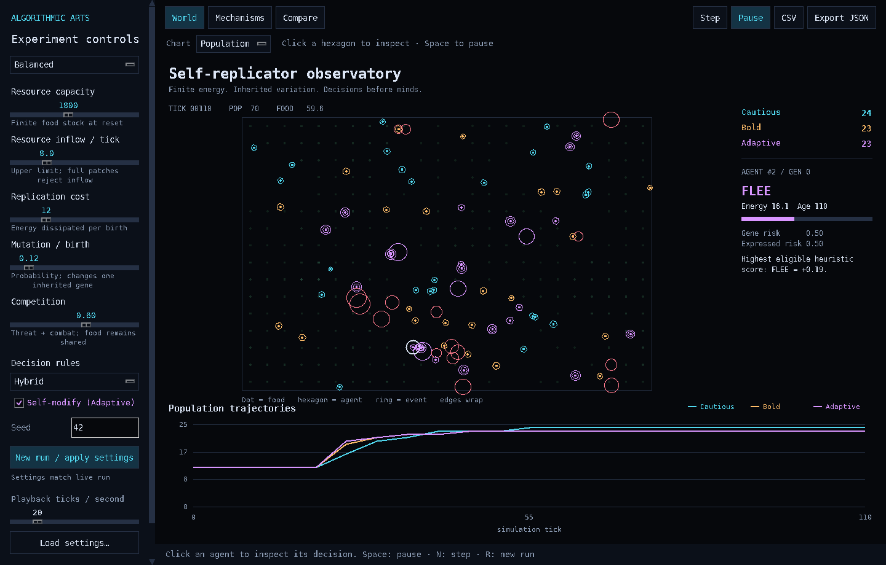
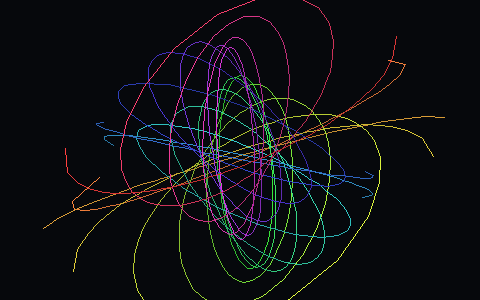
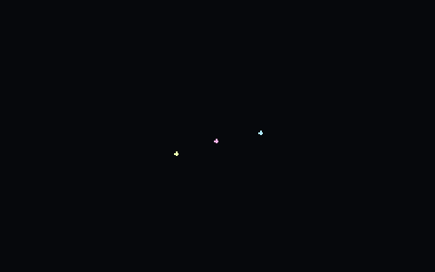
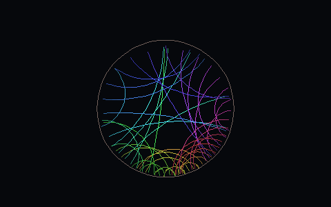
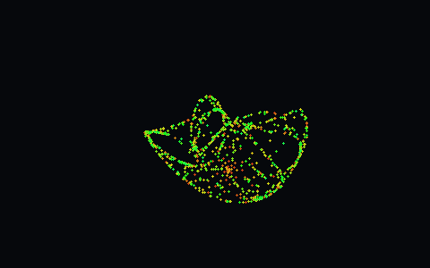
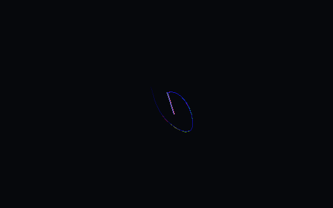
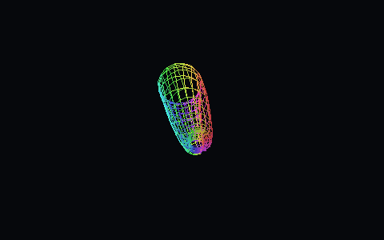
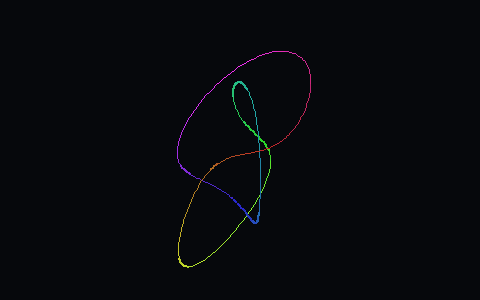
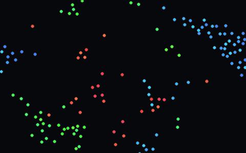

# Algorithmic Arts

**Mathematical animations in pure Python — zero dependencies, one file, stdlib only.**

No pygame. No numpy. No shaders. Just `tkinter`, `math`, and ideas that are older than computers: fiber bundles, chaotic attractors, hyperbolic geometry, n-body gravity. If you have Python, you already have everything this needs.

```bash
python spectral_geometry.py            # windowed art / ambient display
python spectral_geometry.py --selftest # headless render test, no screen needed
```

**Controls:** `Space` / `→` / mouse click — next scene · `←` — previous · `Esc` / `Q` — quit. Scenes auto-rotate every 7 minutes. Live clock + optional system telemetry (CPU/RAM, if `psutil` is present) make it a pleasant second-monitor ambient panel.

---

## Self-Replicator Observatory

An interactive artificial ecology in the same dark, luminous canvas style. **One standalone Python file; no pip dependencies, no server, no network.** Adjust finite resources, replenishment, replication cost, mutation, competition and decision rules. Watch three lineages compete, inspect an agent's reasoning, then compare repeated seeded trials.

```bash
python self_replicator.py
python self_replicator.py --selftest
python self_replicator.py --headless --steps 600 --trials 5 --output experiment.json
```



**World** shows agents, resource patches and population/resource trajectories. **Mechanisms** draws eight visual explanations: architecture, finite energy, replication, mutation, competition, self-modification, evolution and pre-mind decision logic. Diagrams use observed events when available and label illustrative examples. **Compare** reports means, observed ranges and survival across multiple seeds.

**Controls:** `Space` — pause/play · `N` — one tick · `R` — apply settings and restart · click a hexagon — inspect · `←` / `→` — mechanism diagram · `Esc` — cancel comparison. Sidebar changes are pending until **New run**; comparisons use the current sidebar settings. JSON retains trial settings/results; CSV exports the live trajectory.

Python ≥ 3.10; the desktop interface uses `tkinter` (some Linux Python installations supply it as an OS package). Headless mode and selftests work without Tk. [Model, visual guide and reproducible experiments →](docs/self_replicator.md)

---

## Gallery

| | |
|---|---|
|  **Hopf Fibration** — the circles of S³ stereographically projected to 3D: nested tori breathing as the base sphere rotates. The crown jewel of the collection. |  **Three-Body Ballet** — the Chenciner–Montgomery figure-8 choreography: three equal masses under real gravity (velocity-Verlet), weaving one shared orbit from nothing. |
|  **Hyperbolic Flow** — a geodesic web in the Poincaré disk carried by a live Möbius transformation. Escher's Circle Limit, but flowing. |  **Clifford Attractor** — a strange attractor whose four parameters breathe sinusoidally: the form perpetually reborn. |
|  **Chaos Butterflies** — 36 double pendulums differing by 10⁻⁵ radians: a minute of unison, then sensitive dependence tears them apart. The theorem, drawn. |  **Klein Bottle** — a rotating non-orientable surface (bagel immersion) with a breathing scale. |
|  **Torus Knot Morph** — (2,3) → (3,4) → (2,5)… knots smoothstep-morphing into one another. |  **Murmuration Wars** — three boid flocks locked in rock-paper-scissors predation; a caught bird converts to the hunter's colour in a burst ring. |

---

## Why stdlib-only?

Because constraints are the art. Every scene here is:

- **One file, no installs** — runs on any Python ≥ 3.10 with tkinter (the default on Windows/macOS, one package away on Linux)
- **A pooled-canvas renderer** — pre-allocated line items, style caching, quantized HSV: thousands of segments at 30 fps on an office laptop
- **Honest mathematics** — real Verlet gravity, real RK4 pendulums, real Möbius maps and stereographic projections; nothing is a pre-baked path

## Repository layout

```
spectral_geometry.py     # the current piece: 8 scenes, windowed, selftest
self_replicator.py       # interactive ecology, visual explanations, comparisons
docs/self_replicator.md  # model assumptions, controls, experiments
tests/                  # optional native Tk interface smoke tests
series/                  # the evolution: 01→09, fullscreen tkinter experiments
assets/                  # GIF/poster previews + the headless renderer that made them
```

The `series/` folder is the archaeology — nine earlier screensavers (sacred geometry, 4D polytopes, walking creatures, wireframe terrain…) that led here. `assets/render_previews.py` re-renders every preview headlessly (Pillow used only for asset generation, never at runtime).

## License

MIT — take it, remix it, put it on the second monitor of your open-space office.
