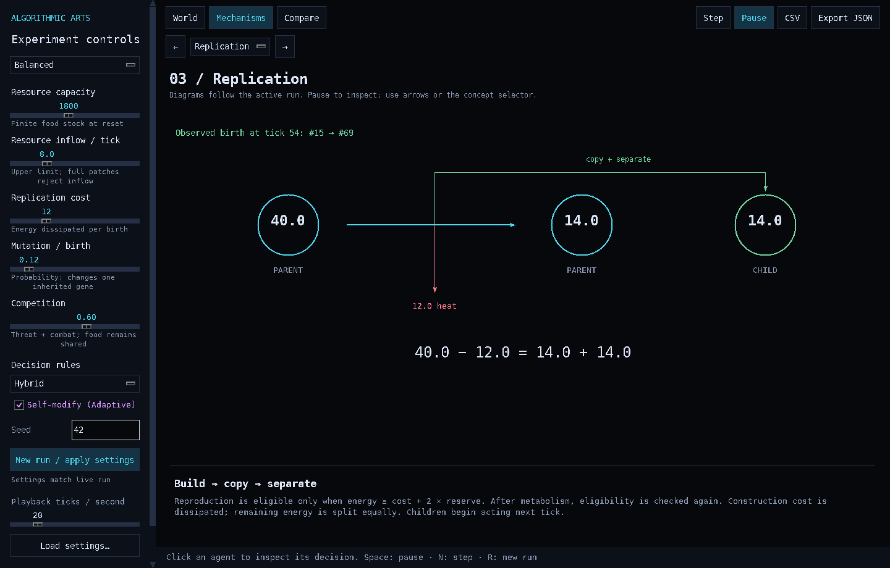

# Self-Replicator Observatory

A small experimental world for asking: **what happens when copying costs energy, resources are finite, competitors share a habitat, and simple controllers can change?**

The app follows Algorithmic Arts' `#06080c` background, monospaced labels, luminous outlines and pooled Tk canvas rendering. The simulation is independent of rendering and playback speed. All runtime code, built-in model tests and headless execution live in `self_replicator.py`.

## Run

```bash
python self_replicator.py
```

Requires Python 3.10 or later. No `pip install`, NumPy, pygame, matplotlib, web browser, accounts or server. The GUI uses the standard-library `tkinter` module and a desktop display. On Linux, some Python distributions package Tcl/Tk separately (for example `python3-tk` on Debian/Ubuntu). Headless experiments do not import Tk.

The application does not contact a network or create files unless you explicitly export. Agents are in-memory records; they do not copy executable files or modify Python source.

## The visual language

| Visible element | Meaning |
| --- | --- |
| Green patch/dot | Available food; brightness is fraction of local capacity, size also reflects amount |
| Cyan hexagon | Cautious founder lineage, initial risk 0.20 |
| Amber hexagon | Bold founder lineage, initial risk 0.80 |
| Violet hexagon | Adaptive founder lineage, initial risk 0.50 |
| Hexagon radius | Stored energy, visually capped for legibility |
| White selection ring | Inspected agent; selection remains attached to its identity |
| Violet thin halo | Acquired behavioral adjustment differs from the inherited gene |
| Expanding green / red / violet ring | Birth / fight / parameter adjustment |
| Population line | Living descendants of one founder strategy, including mutants |

Colors are stable semantic identities. Unlike ambient color cycling, this lets you follow a lineage through selection. The world wraps at its edges. Decorative ring overlap does not itself imply an interaction.

## Eight diagrams, connected to the simulation

| Mechanism | What the app draws | What to examine |
| --- | --- | --- |
| Architecture | Boundary, three gene bars, interpreter, resource → constructor → copier → separator flow | A description requires machinery and energy to produce an independent copy. This is a structural schematic. |
| Finite resources | Stacked energy budget with field, stored energy and cumulative heat | Initial budget + actual inflow = field + agents + dissipation. The numerical residual exposes accounting errors. |
| Replication | Parent before construction → parent and child after a split, with a cost arrow to heat | The diagram shows the latest observed birth and its energy values. Before the first birth it labels an illustration. |
| Mutation | Aligned parent/child gene bars, highlighting the changed value | A mutation affects one gene in a newborn; it does not edit the parent. |
| Competition | Two agents drawing from the same patch, plus encounter transfer and injury | Exploitative competition for food persists when direct combat is disabled. Latest fight values appear below. |
| Self-modification | Inherited risk, expressed risk before experience, expressed risk after experience | Within-lifetime parameter changes cost energy and do not pass to offspring. |
| Evolution | Stacked histogram of inherited risk among survivors, lineage means and birth counts | Follow changing heritable variation and differential reproduction; population growth alone is insufficient evidence. |
| Decision logic | Pre-action energy/danger/escape inputs → rule evaluation → eligible action scores or reflex result | Click a living agent in World, advance a tick, then inspect its actual latest decision. |

All diagrams are generated from canvas primitives. There are no prerecorded model animations or image dependencies at runtime. When an event has not occurred yet, the corresponding illustrative example is explicitly labeled.



## Controls and experiment discipline

- **Resources** sets total initial food and the maximum field stock. All founders additionally start with 18 energy units, included in the accounting ledger.
- **Inflow** sets the upper bound on resource addition per tick. Food enters patches in proportion to local capacity and is rejected by full patches.
- **Replication cost** is dissipated energy per birth.
- **Mutation** is the probability of changing one inherited gene at a birth, not a per-tick probability.
- **Competition** scales perceived threat, encounter probability and stolen energy. Shared food remains competitive at zero.
- **Decision rules** selects Reflex, Utility or Hybrid for all three lineages.
- **Self-modify (Adaptive)** enables only the violet lineage's within-lifetime risk adjustment.
- **Seed** controls terrain and seeded agent dynamics; repeat the same configuration and seed to reproduce the same run within the same Python/model version.
- **Playback speed** changes ticks per wall-clock second, never model parameters or the length of a tick. Slow machines may run below the requested speed.

Changing a setting does not silently alter an ongoing live run. Press **New run / apply settings** to restart from tick zero. **Run comparison** captures pending settings immediately, runs all three lineages together in every trial, and pauses the live simulation. Changes made during a comparison apply to subsequent experiments only. Cancel discards incomplete trial results and retains the previous completed comparison.

**World** supports a population or resource-stock chart. **Compare** offers 3, 5 or 10 trials, each 300, 600 or 1200 ticks, using consecutive seeds from the starting seed. It reports final population mean, observed min–max, count of trials with survivors, and mean births, plus mean population trajectories. These are descriptive summaries; the ranges are not confidence intervals. Extinction is retained in the results.

**JSON export** includes exact configs, seeds, model version, sampled trajectories, birth/death counts, risk means, mutation/adaptation counts, the energy ledger, latest events and cumulative action counts for the live run and every completed comparison trial. **CSV export** includes the live trajectory with its seed and complete config on every row. **Load settings** reads either format of JSON export or a bare config object, and populates pending controls. It restarts a seeded experiment; it is not a mid-run checkpoint loader.

The chart history initially samples every 5 ticks. After 2,000 samples it progressively decimates, retaining the origin; exports always append the exact current endpoint. Tick indices are included, so an exported long run does not imply uniform original sampling.

## Model specification

### State and update order

The environment is a periodic 24 × 16 patch grid. Nine smooth food hotspots plus a small background determine capacity. By default there are 12 founders per lineage. Each group of three starts at the same sampled position, with equal energy, efficiency and reserve. The only initial genetic difference is risk. This matched, mixed start deliberately permits immediate interaction; no lineage starts in a richer territory by construction.

Each fixed tick:

1. Add bounded environmental inflow.
2. Shuffle living agents with the run's private random generator.
3. For each agent, sense nearby food and competitors; evaluate the selected controller.
4. Pay metabolism, then execute the action, including its extra costs.
5. If eligible, adjust the Adaptive agent's expressed risk.
6. Remove dead agents; add children, which first act on the following tick.
7. Record the trajectory on the current sampling schedule.

Sensing uses current positions/energy as sequential turns execute, not a simultaneous global optimization. Nearby candidate lookup uses spatial buckets. A fight is attempted at most once per unordered pair per tick. Maximum lifespan is 1,400 ticks; residual energy at that age is dissipated. There is no corpse recycling.

### Genome and heredity

| Gene | Allowed range | Effect |
| --- | --- | --- |
| Risk | 0.05–0.95 | Threat threshold and action preference |
| Efficiency | 0.60–1.40 | Harvest ceiling `0.70 + 0.55 × efficiency`; higher efficiency also raises maintenance cost |
| Reserve | 8–20 | Minimum energy allotted to each side of a successful reproductive split |

A lineage label is inherited unchanged. New strategies are not synthesized. On a mutation, one randomly selected gene changes by a uniformly sampled 4–16% of its allowed range, with a random sign reflected at a boundary. The child inherits the altered genome; the parent retains its own genome. Mutation does not automatically optimize fitness.

### Reproduction and energy accounting

Reproduction is eligible if `energy >= construction_cost + 2 × reserve`, and the computational population cap has room. Eligibility is rechecked after the parent's metabolism is charged. Then:

```text
parent energy after = child energy = (energy before − construction cost) / 2
```

There is one external energy input: regrowth. Foraging and stolen energy are transfers. Metabolism, movement, construction, injury, adaptation and age-related death are dissipation. The ledger must satisfy:

```text
initial food + initial founder energy + cumulative actual inflow
    = remaining food + living agents' energy + cumulative dissipation
```

Basal metabolism is `0.07 + 0.03 × efficiency²` per tick. REST pays 45% of this; FREEZE pays 65%. Neither creates energy. FORAGE additionally pays 0.025, FLEE 0.14, and FIGHT 0.09. Movement is capped at 0.32, 0.62 and 0.42 patch widths respectively. A fleeing or fighting agent does not forage that turn.

Agents sense opponents within 2.2 patch widths. Relative strength is `(own energy + 2) / (opponent energy + 2)`. Danger is competition × proximity × a bounded opponent advantage, clipped to 1. Escape is possible if a neighboring target reduces summed nearby threat pressure. Combat needs distance < 0.9 and an encounter draw below `0.35 × competition`. Win probability is proportional to stored energy plus 2. Both agents lose 0.8–1.4 energy to injury. The winner receives at most 30% of the loser's remaining energy and at most `3 × competition`.

### Decision controllers

The six actions are **FORAGE, REPRODUCE, FLEE, FIGHT, FREEZE, REST**.

**Reflex:** threshold = `0.18 + 0.48 × expressed risk`. At or above threshold, a sufficiently bold and relatively strong agent fights. Otherwise it flees if a lower-pressure route exists, fights if trapped but stronger, or freezes. Below threshold it reproduces if eligible, otherwise forages if food is available, otherwise rests.

**Utility:** eligible actions receive explicit heuristic scores. They combine expected food, energy reserve, danger, risk preference and relative strength. Ineligible actions are absent from the score table. `decide()` contains the complete equations; the decision diagram shows the actual signed score for every eligible action. Scores are engineering choices in arbitrary utility units, not calibrated survival probabilities.

**Hybrid:** danger ≥ 0.65 invokes the survival reflex, with open escape prioritized. Otherwise it uses Utility. All lineages use the chosen controller; their genes and Adaptive's acquired offset affect its choices.

### Within-lifetime self-modification

Every 40 ticks of its own age, an Adaptive agent with at least 1 energy considers a risk adjustment. Recent injury lowers its offset by 0.08; otherwise an energy drop of more than 1 since its prior checkpoint raises the offset by 0.08. The offset remains between −0.25 and +0.25. Each effective change costs 0.35 energy. Expressed risk is inherited risk plus offset, clipped to 0.05–0.95. Offspring reset the offset to zero.

This is deliberate **parameter-level self-modification**. It provides a clean distinction between an inherited description and acquired behavior. It is not arbitrary source-code rewriting, an optimizer, or evidence that the agent has a mind. A reactive adjustment can be counterproductive; Adaptive is not guaranteed to win.

### Computational bounds and interpretation

The maximum population is 360. A visible warning and exported `cap_hits` report when reproduction was blocked by this computational guard. Treat such results as capped experiments, not a discovered carrying capacity. The model has no chemical machinery, sexual reproduction, species formation, general intelligence, or calibrated biological timescale. Selection here operates on a small engineered parameter space and fixed policy families.

## Five useful experiments

Use the same seed or seed set while changing one variable. Compare distributions across seeds before making a claim.

| Question | Change | Inspect |
| --- | --- | --- |
| Can copies grow without fresh energy? | Balanced → Closed budget | Resource stock, birth burst, then energy depletion; finite-budget diagram |
| Is direct aggression always helpful? | Competition 0 → 0.6 → 1 | Repeated survival/population results and injury costs; food competition remains at zero |
| What does expensive copying select for? | Replication cost 6 → 12 → 30 | Birth counts, reproductive reserves, final population ranges |
| Does variation improve this population? | Mutation 0 → 0.12 → 0.65 | Inherited risk distribution, efficiency/reserve mutation events, repeated outcomes |
| Does acquired adjustment help? | Self-modify off → on, otherwise identical | Adaptive outcome over the same seeds; gene risk vs expressed risk; adaptation's cost |

To separate policy design from heredity, repeat an experiment with Reflex, Utility and Hybrid while holding the remaining settings fixed.

## Headless experiments and validation

```bash
# No display or tkinter required:
python self_replicator.py --selftest
python self_replicator.py --headless --seed 42 --steps 600 --trials 5 --output experiment.json

# Load the precise configuration from a prior export and use a new seed set:
python self_replicator.py --headless --config experiment.json --seed 100 --output repeat.json

# Optional native interface tests; skipped cleanly when a display is unavailable:
python -m unittest discover -s tests -v
```

The built-in suite checks deterministic replay and rendering independence, energy conservation, lineage accounting, extinction under an empty budget, replenishment bounds, energy-conserving births, non-inheritance of acquired changes, mutation/no-mutation behavior, action eligibility, combat disabled at zero competition, periodic geometry, cap signaling, trajectory retention, export/reload, summary statistics and diagram geometry. Native Tk tests exercise setting application, playback, stepping, agent selection, all eight diagrams at the minimum window size, pooled item reuse, comparison freeze/cancel/completion, export/reload and the scheduled event loop.

The baseline integration was validated on Python 3.12 with Tk 9 under a virtual X display. Windows and macOS native rendering have not been exercised in that environment.
